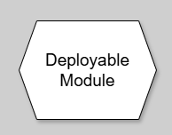
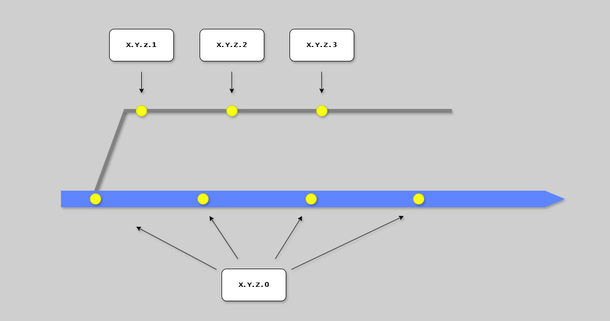

# Deployable Modules

## Introduction

A Deployable Module is the fundamental building block of Continuous Delivery.

It represents the discrete body of work that is built, tested, and delivered as a cohesive whole.

{width=150}

---

## Definition

**Deployable Module:** The discrete body of work that is built, tested, and delivered.

**Key Characteristics:**

- Composed of one or more immutable artifacts
- Has its own version number
- Progresses through CD Model stages independently
- Can be deployed without horizontally testing with other modules
- Lowest level of granularity for repository decomposition

**What a Deployable Module Is NOT:**

- Not arbitrary code in a repository
- Not a feature or user story
- Not an internal module (unless independently deployable)

---

## Types

Deployable modules fall into two primary categories with different distribution models.

### Runtime Systems

Services, applications, or systems that run continuously to serve users.

**Examples:**

- Microservices
- Modular monoliths
- Web applications
- Data pipelines
- Background workers
- APIs (REST/GraphQL/gRPC)
- Store apps (mobile/desktop)

**Characteristics:**

- Continuously running in production
- Serve real-time requests or process data
- Typically versioned with CalVer
- Only one version active in production at a time
- "Software as a Service" model

### Versioned Components

Libraries, tools, or containers consumed by other systems.

**Examples:**

- Container images
- npm/NuGet/pip/Go packages
- CLI tools and executables
- Automation modules
- Contract packages (API schemas)

**Characteristics:**

- Consumed via dependency management
- Multiple versions exist simultaneously
- Typically versioned with SemVer
- Consumers control which version they use
- "Multiple Releases in the Wild" model

---

## Versioning Strategies

### Version Number Format

Semantic Versioning uses a three-component core: **MAJOR.MINOR.PATCH**, optionally
followed by prerelease and build metadata, for example `1.2.3-rc.1+build.4`.
Choose the bump by compatibility, not by branch commit count.

A four-component assembly/file version such as `1.2.3.4` is a separate,
platform-specific coordinate, not SemVer. A branch-count field can be useful
for those coordinates but does not define the SemVer patch.

### Schemes by Module Type

| Scheme            | Use For                     | Format                            | Example               |
| ----------------- | --------------------------- | --------------------------------- | --------------------- |
| **Implicit**      | Internal monorepo modules   | Commit SHA                        | -                     |
| **CalVer**        | SaaS runtime systems        | `YYYY.MMDD.HHMM.Patch`            | `2024.1115.2030.0`    |
| **Manual SemVer** | Explicit compatibility bump | `MAJOR.MINOR.PATCH` | `1.5.3` |
| **Auto SemVer** | Libraries, multi-release | `MAJOR.MINOR.PATCH` | `2.3.12` |
| **Assembly/file** | Platform-specific build coordinate | Four numeric components | `1.2.3.4` |
| **API Version**   | Runtime APIs                | Service: CalVer, Interface: v1/v2 | `2024.1115.0` + v1,v2 |

### Choosing a Strategy

| Module Type              | Distribution Model    | Strategy         |
| ------------------------ | --------------------- | ---------------- |
| Microservice             | SaaS (single version) | CalVer or SemVer |
| Web application          | SaaS (single version) | CalVer or SemVer |
| CLI tool                 | Multi-release         | SemVer           |
| npm/NuGet package        | Multi-release         | SemVer           |
| Container image          | Multi-release         | SemVer           |
| Internal monorepo module | Not distributed       | Implicit         |
| REST API (interface)     | Multi-version support | API (v1, v2)     |

### Optional Branch-Count Build Field



For a platform-specific four-component version, a build field may track branch
commits. This is not the SemVer patch and is not cicd's release-version policy:

- **Main branch commits**: build field = 0
- **Release branch commits**: build field = count since branch point

```bash
# Get a branch-count build field (not a SemVer patch)
git rev-list main.. --count
```

---

## Immutable Artifacts

Deployable modules are built into immutable artifacts that progress through the pipeline unchanged.

### What is an Immutable Artifact?

A versioned, unchangeable output from the build process.

**Key Properties:**

- Built once (in pipeline)
- Never modified after creation
- Same artifact deployed to all environments
- Uniquely identified by version and checksum
- Stored in artifact registry

### Why Immutability Matters

- **Consistency**: What you test is what you deploy
- **Traceability**: Exact artifact version in each environment
- **Security**: Signed artifacts prove integrity, tampering detectable
- **Compliance**: Required for regulated industries

### Artifact Types

**Container Images:**

```text
registry.example.com/api-service:1.2.3
```

**Application Packages:**

```text
api-service-1.2.3.zip
api-service-1.2.3.tar.gz
```

**Library Packages:**

```text
@company/shared-utils@1.2.3
company.shared-utils.1.2.3.nupkg
```

### Configuration vs Artifacts

**In the artifact:**

- Application code and dependencies
- Default configuration structure
- Static assets

**NOT in the artifact (injected at deployment):**

- Database connection strings
- API keys and secrets
- Environment-specific URLs
- Feature flag states

---

## Granularity

Defining the right boundaries is a critical architectural decision.

### Too Coarse

Large monolithic modules cause:

- Long build/test times
- All changes bundled together
- Difficult rollback
- Team coordination bottlenecks

### Too Fine

Over-segmentation causes:

- Complex dependency management
- Version compatibility challenges
- Coordination overhead
- Difficult cross-cutting changes

### Right Balance

Good boundaries have:

- Clear responsibilities
- Minimal coupling with other modules
- Can be tested in isolation
- Can deploy independently
- Owned by a single team

See [Trunk](trunk.md) for monorepo vs polyrepo patterns that affect granularity decisions.

---

## Next Steps

- [Unit of Flow](unit-of-flow.md) - How modules fit the 4-component model
- [Trunk](trunk.md) - Repository patterns for modules
- [Pipeline](pipeline.md) - How modules flow through stages
- [Live](live.md) - Where modules are deployed/published

## References

### Internal

- [CD Model Overview](../cd-model/overview.md)
- [CD Model Stages](../cd-model/stages.md)

### External

- [Semantic Versioning (SemVer)](https://semver.org/)
- [Calendar Versioning (CalVer)](https://calver.org/)
- [Conventional Commits](https://www.conventionalcommits.org/)
